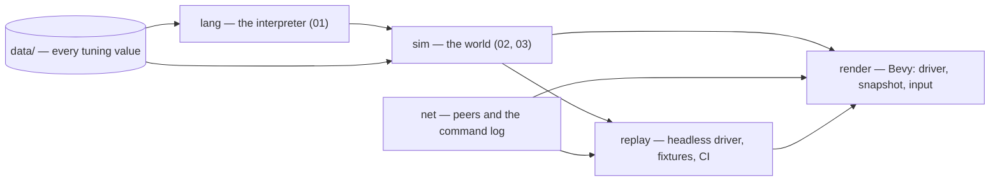

# 06 — Architecture

The crates, the driver, the tick loop, the command log, the snapshot and
the testing strategy: how the pieces the other docs specify are arranged
into a program that runs the same on every peer. This doc is normative for
everything that crosses a crate boundary or decides when a tick runs; two
implementers reading it must produce the same state hash on every tick
(design-invariant DI7).

## Decided

Rulings this doc owns, moved here from the overview when it was written.

- **The game is lockstep multiplayer, and `sim` is renderer-free plain
  Rust** — the two facts fixed before any question was asked, restated from
  the overview because every rule below follows from them.
- **The sim has no rate; the players choose the speed together (Q6).** A
  tick is the unit of simulated time and every duration is a count of ticks.
  How many ticks pass per real second is a `SetSpeed` command in the log,
  agreed for a tick like a deploy, applied by each peer's driver and never
  read by the sim, from a closed list of steps in data with `0` as pause;
  the map sets the starting speed. The renderer interpolates between
  completed ticks.
- **The player may mark the map, and everything the player does enters one
  ordered command log (Q10, as amended by Q26, Q27, Q28 and Q56).** Besides
  `Deploy`, the log carries `Mark` and `Unmark`, which place and withdraw
  plans that only a bot makes real, `SetSpeed` (Q6) and `Resign`, which
  removes the sender's team on the agreed tick. A mark changes what a
  program can read about a tile and never what a machine does: the player
  authors programs and marks the map, and never commands a machine. Every
  command carries its sender and its tick; one that cannot apply is
  dropped. A plan is of four kinds — paint, overlay, building and, as Q56
  added, wire. What a mark is and does is [02-machines](02-machines.md)'s
  and [03-world](03-world.md)'s.
- **A fixed delay, and a stall for a late peer (Q12).** A command entered
  at tick `t` is agreed for `t + delay`, a tuning constant in ticks fixed
  at match start; a peer missing another's command set for the next tick
  issues no tick until it arrives, so nothing is dropped and nothing
  desyncs. Single-player is lockstep with one peer and feels the same
  delay. Within a tick, commands apply by the tick they were agreed for —
  tick 0's opening set before tick 1's own, the one tick that carries two —
  then sender, then submission order. Rate-limiting is deferred with PvP;
  the sender stamp is its hook.
- **A paused driver still reaches a command, and a hook's wait spends its
  budget (Q32, as Q55 amended).** At speed `0` the driver runs, without the
  clock, exactly the ticks up to the next one that carries a player's
  command — a scripted team is a sender in the log but not a player, and
  its commands, written in advance (`04`), do not count, or a pause would
  run to the script's next entry — so a `SetSpeed` above zero
  lands and resumes; `delay` and `stall_report_ticks` live in
  `data/net.toml`. The hook half is
  [01-language](01-language/execution.md)'s.
- **Bevy renders, in its own crate, in the sim's process, changing the
  match's sim only through the command log and reading it through
  completed-tick snapshots and the debugger's three read-only channels
  (Q15, as Q55 amended).** The three are: breakpoint watches the driver
  passes into `sim.step`, its hit reports, and its full state saved between
  ticks; none changes the world or the hash, and the debugger and a
  replay's playback drive forks of their own (Forks). A `render` crate
  depends on `sim` and Bevy; `sim` depends on neither. The driver — wall
  clock, speed, peer wait, next tick — is a Bevy system that owns the sim
  as a resource; every other system but the debugger and a replay's
  playback sees only the snapshot the sim publishes after each tick, from
  which the renderer's own entities are built. Interpolation is in floats
  and never read back. Input becomes commands the renderer submits and
  forgets. Headless — `sim` plus a driver with no Bevy — stays the build CI
  runs.
- **A program is debugged on a fork, a private copy of the sim that never
  feeds back into the match (Q55).** The match's sim gives the debugger
  only Q15's three read-only channels above; stepping, rewinding, editing
  a variable and what-if all act on a fork, and a replay plays on one (The
  driver). In a live PvP match a fork never passes the live tick and never
  diverges. The amendment to the paused driver is Q32's entry above.
  Forks, below; the player's side is [07-interface](07-interface.md)'s.

## Crates



| Crate | Depends on | Owns | Floats |
|---|---|---|---|
| `lang` | nothing | the interpreter [01-language](01-language.md) specifies: the loader, the evaluator, the interrupt machinery, `num` | none |
| `sim` | `lang` | the world: tiles, machines, the tick loop, the state hash, the snapshot; the game builtins `02` names, which it registers with `lang` | none |
| `net` | `sim`'s command types only | the command log as a data structure and its exchange between peers: stamping, the per-tick sets, the stall | none in anything it sends |
| `render` | `sim`, `net`, `replay`, Bevy | the driver, the ECS built from snapshots, interpolation, input, the editor, the mark tools, the log view, the debugger driving forks and replays played on one (Q55) — what each shows is [07-interface](07-interface.md)'s | yes, and only here |
| `replay` | `sim`, `net` | the headless driver: runs a `(map, command log)` to a hash stream; the replay's file format, the saver's team in it (Q55), which `render` writes when a match ends (Q36); building a fork from a replay; the golden fixtures; the determinism suite; the cross-architecture check | none |

**The arrow that does not exist** is any edge into `sim` or `lang` from
`render`. The compiler enforces it: `sim` has no `render` dependency, and a
`render` type cannot appear in a `sim` signature. The review rule CLAUDE.md
states — flag any code that feeds sim state from the ECS side — covers what
the compiler cannot see: a `render` system holding a mutable reference to
the sim resource outside the driver. A fork (Forks) is not that resource
and is a type of its own, so the debugger's systems and a replay's
playback may hold one mutably.

**`lang` is separate from `sim`** so the determinism suite can run the
interpreter on its own fixtures (T14) without a world, and so the
`arithmetic_side_effects` lint reaches it as a workspace member.

## The driver

The driver is the loop that decides when a tick runs. Two exist — the Bevy
system in `render`, and the headless one in `replay` — and they share one
contract:

```text
loop:
    if debugger.asked_for_state():               # true once per ask (07,
        debugger.keep(tick, sim.save())          # Saved states; Q55)
    first = 0 if tick == 0 else tick + 1         # tick 0 is never stepped:
                                                 # its set applies with tick 1
    if speed == 0:
        T = net.next_tick_with_a_player_command(tick, scripted)
                                                 # lowest T > tick with a
                                                 # command from a team not
                                                 # in `scripted`, the teams
                                                 # the driver loaded scripts
                                                 # for (Q55)
        if T is None: wait for a command; continue
        if not net.have_all_sets(first ..= T): stall; continue
        # run the ticks up to T without consulting the clock (Q32)
    else:
        wait until (real time since last tick) ≥ 1 / speed
        if not net.have_all_sets(first ..= tick + 1): stall; continue
    commands = net.sets_for(first ..= tick + 1)  # every peer's, ordered
    sim.step(commands, watches)                  # exactly one tick; watches
                                                 # are the debugger's (Forks)
    snapshot = sim.snapshot()                    # published, never shared
    hash = sim.hash()                            # sent to peers, checked
    tick += 1                                    # the tick just completed
    if debugger.wants_state(tick):               # a multiple of N (07)
        debugger.keep(tick, sim.save())          # the full state, for forks
```

- **`sim.step` is the only entry point that changes the world**, and it
  takes the tick's full command set, with the team's watched lines when
  the player has breakpoints (Forks). A fork is not the match's world and
  has entry points of its own (Forks). There is no other mutating call on the
  sim; the snapshot and the hash are reads.
- **Speed lives in the driver**, set by the `SetSpeed` command when
  `sim.step` reports it applied. The sim carries no rate (Q6). **A paused
  driver still reaches a command** (Q32): at speed `0` it runs, without the
  clock, exactly the ticks up to the next one that carries a player's
  command, a scripted team's not counting (Q55) — which is how a
  `SetSpeed` above zero lands on its agreed tick and resumes.
- **The stall** (Q12) is the driver refusing to call `sim.step` until every
  peer's set for the next tick is in hand. The renderer keeps drawing the
  last snapshot. After `stall_report_ticks` (`data/net.toml`, beside
  `delay`) of real time at the current speed, the driver reports the absent
  peer to the player; what the player
  may do then — wait, or resign — is `render`'s UI and not a sim rule.
- **Single-player** is the same loop with one peer, whose sets are its own
  and always in hand, so the delay is felt and the stall never fires.
- **A replay is played on a fork** (Q55, Forks), not by this loop: it is
  not a match and has no one to agree with. `render` opens a fork from the
  replay's `(map, command log)` — its **playback** — and steps it a tick at
  a time at the viewer's pace, passing the team's watches as this loop
  passes them, so it reports hits as `sim.step` does and stops at none. Its
  speed and pause are the viewer's, so the `SetSpeed` commands in its log
  apply to the world as recorded and set nothing, and a paused replay stays
  paused. It takes no edit and no what-if, so it reproduces the recorded
  match hash for hash, and the debugger forks from it as from a match
  (`07`). It saves states as `07`'s Saved states rules; they are its own,
  so a seek to a tick restores the latest saved at or before it and runs
  on, unless the playback already stands between that state and the tick,
  when it simply runs on. A seek runs without watches, so it reports no
  hits on the way; the playback takes them again once it stands at the tick
  asked for. This bullet is the one statement of a seek. The headless
  driver in `replay` still runs a replay through this loop to its hash
  stream, with no debugger, so it saves nothing.

## The tick

`sim.step` runs one tick in this order, and the order is spec:

1. **Apply the tick's commands**, by agreed tick, then sender, then
   submission order (Q12):
   `Deploy` writes a bundle into a deployment slot;
   `Mark` and `Unmark` set and clear plans (`03`); `SetSpeed` is recorded for
   the driver; `Resign` marks the sender's team **out**, which step 5
   applies.
2. **Every machine's slice**, in ascending entity id: its main flow or
   handler runs until its tick budget is spent or it yields at a restart
   (`01`, Metering), with interrupts delivered at its boundaries; an
   unpowered machine's main flow does not run, though a handler does (`02`,
   Power; Q56). Actions begun in a slice begin in this order, and actions
   completing on this tick complete in ascending entity id after every
   slice has run.
3. **Action completions**, in ascending entity id: moves land, transfers
   happen, prints count down and place bots, sites complete,
   deconstructions finish, wires are laid and removed (`02`); an unpowered
   machine's main-flow action, print or construction does not count down
   (`02`, Power). A bot printed this tick has its first slice next tick.
4. **Damage and death**: health changes from this tick's causes are applied
   — attacks that completed, and every printer's defence against adjacent
   enemy bots (Q30) — `dying` and `death` are raised where Q24 says, and
   `death` epilogues remove machines; a printer left at or below zero health
   loses its print in progress (`02`, Printing). Every machine whose `death`
   epilogue ran this tick — here, or earlier in its own step-2 slice — is
   removed together at the end of this step; until then it keeps its tile,
   and a printer among them still defends in this step. A machine removed
   here is absent from everything below.
5. **Out teams**: every team that is out — it resigned this tick, or steps
   3 and 4 left it with no printer, by deconstruction or death (`04`) — has
   its machines removed, its plans cleared and its log closed, in team
   order.
6. **Power and printing**: in team order, each team's grid is traced, its
   supply summed and its machines powered, oldest first, which holds until
   the next tick's step 6 (Q56; `02`, Power); then its printers that are
   ready, powered and above zero health begin prints by turns until its
   bots and prints in progress reach its cap or its spare power runs out
   (Q42; `02`, Printing).
7. **Regrowth**: every deposit grows (`03`).
8. **The vision pass**: each team's visible tiles are computed and their
   snapshots refreshed (Q21).
9. **The state hash** over everything below.

Nothing else happens in a tick. A rule that needs another step is a change
to this list and a new question number.

## The command log

A **command** is:

| Field | Holds |
|---|---|
| `tick` | the tick it is agreed for: `submitted_at + delay` |
| `sender` | the team submitting it |
| `seq` | the sender's submission counter, for ordering within a tick |
| `kind` | `Deploy`, `Mark`, `Unmark`, `SetSpeed`, `Resign` |
| `payload` | `Deploy`: a deployment name and a bundle (the files, byte-exact — `01`, The bundle); `Mark`: a tile, a plan kind and a value; `Unmark`: a tile and a plan kind; `SetSpeed`: a step; `Resign`: nothing |

- **A tick's set** from a sender is every command of that sender with that
  `tick`, in `seq` order; an empty set is sent explicitly, so absence is
  never ambiguous.
- **Validation at submission** refuses what can never apply — a tile off
  the map, a step not in the list, a `Deploy` naming a deployment other
  than `bot`, `printer` or `depot` (Q42), a bundle that fails to load
  (`01`) — so
  the log holds only commands every peer would accept. A command that
  cannot apply *on its tick* — a `Mark` on a tile the sender has since lost
  the right to, or a paint or overlay plan on a tile that is not ground
  the sender has seen (Q49), a `Resign` from a team already out — is
  dropped in
  `sim.step` and recorded nowhere.
- **The log is append-only and complete**: every command every peer ever
  applied, in order — a scripted team's commands (`04`) among them, since
  they enter the log like any peer's. `(map, command log)` is a replay, and
  the log's bytes are hashed into the replay's identity as the map's are,
  each length-prefixed as rule 7 hashes a bundle. A saved replay also
  records the saver's team (Q55), for the debugger; it is outside the
  identity, so two peers' files of one match are one replay.
- **Encoding** on the wire and on disk is one canonical byte layout per
  kind, length-prefixed like the bundle hash (`01`), so that the log hashes
  identically everywhere. `net` owns the layout; it is spec once written and
  changes only under a new question number.
- **The opening program set** (Q9) is the first entries: one `Deploy` per
  deployment the team has a program for, `tick` 0, `sender` the team, in
  team order; a deployment with none runs the empty program (`02`) until a
  later `Deploy`. No tick 0 is ever stepped: the first `sim.step` is tick
  1, and tick 0's commands apply in its step 1, before tick 1's own.

## The snapshot

After every tick the sim publishes a **completed-tick snapshot**, a plain
value with no reference into the sim:

| Part | Holds |
|---|---|
| `tick` | the tick just completed, and the speed in force — the driver's number, carried for the renderer, not the sim's |
| `machines` | every machine's attribute record (`02`), plus its diagnostic log entries from this tick |
| `tiles`, per team | every tile's record as that team sees it: state, terrain, deposit, paint, overlay, building, plans, `seen_at` (`03`) |
| `sounds` | every sound emitted this tick, with its cause, position, loudness and tick |
| `faults` | every machine's fault record (`01`) |
| `teams` | each team's deployments, their bundles' versions, its cap, its bot count |

The renderer reads it and builds its own entities; nothing in it is shared
with the sim, and nothing the renderer does to it reaches the sim. It is
also what the replay tool writes out when asked, so a replay can be
inspected without a renderer. The diagnostic log (`02`, `log`) is part of the
snapshot and **not** of the state hash.

## The state hash

The hash is FNV-1a 64-bit over a canonical encoding of the world after step
8, in this order: the tick; every team in order — whether it is out, its
deployments, the version of each bundle, its cap, its print turn (Q42), its
plans by tile in row-then-column order, its memory table by tile; every
tile in row-then-column order — terrain, deposit, paint, overlay, its
wires' teams in order (Q56); the next entity id; every machine in ascending
entity id — every attribute, whether it is `dying`, its action in progress
and `progress`, a site's construction ticks and the model it becomes, its
store capacity, which for a site is its price, fixed at placement (Q42),
its fault record, and its **execution state**: the program counter, every
frame's locals, every global, the deficit, the pending interrupt set,
whether it is in main flow or a handler and which kind, the hook budget
spent so far in that handler, and the set of modules already run in this
run (`01`). Every `num` is its i128; every `str` its UTF-8 bytes
length-prefixed; every collection its elements in iteration order.

The sounds of the tick just run are hashed after the machines, in emission
order — cause, position, loudness, tick — since `hear()` reads them next
tick: they are stored for one tick, and a peer that heard differently would
otherwise agree on the hash until a program acted on it.

What is **not** hashed: the diagnostic log, the speed (the driver's, not the
sim's), anything the renderer holds, and the live sightings, which are a
function of the world rather than part of it (Q7).

Two peers whose hashes differ on a tick have desynced. `net` reports it, the
driver stalls, and the replay tool reproduces it from `(map, command log)`
on either peer — which is the whole reason the log is complete.

## Forks

A **fork** (Q55) is a private copy of the world, for debugging. It is the
match's sim's code run on a copy: it starts from a **saved state** — the
match's full world, execution state included, at the end of a tick, which
the driver saves for the debugger — or, failing one, from `(map, command
log)` re-run, and its state hash there equals the match's. On a replay, the
playback (The driver) stands for the match throughout this section: its
saved states are the match's, and the replay's log, complete from the
start, is the match's log. It runs the tick loop of The tick unchanged. It
is never a peer and never the match's sim: it sends nothing to any peer,
and nothing it does reaches the match's world, log or hash. The rule that
`sim.step` is the only entry point that changes the world, and the review
rule on mutable references (Crates), are the match's sim's; a fork has the
further entry points below. A fork is a type of its own in `sim`, wrapping
a world, and those entry points are its alone: the match's sim has no stop,
restore or edit to call, so the compiler refuses one on it, as it refuses
the arrow (Crates). `sim` holds a fork's code, `render`'s debugger and a
replay's playback drive one, and `replay` builds one from a replay file.

- **Positions.** A point in a tick is a **position**: `(tick, machine, n)`,
  the `n`-th boundary that machine's slice passes this tick — every
  boundary `01` names counts, the slice's opening one, those inside a wait
  and a restart's included; `(tick, damage, machine)`, in step 4 after the
  tick's damage is applied and before that machine's `death` removes it;
  or `(tick, end)`, after step 9. Positions are ordered as the tick runs
  them: by tick; within a tick, slice positions by machine id, then `n`;
  then damage positions by machine id; then the end. A **saved state** at
  the end of tick `T` sits after every position of `T` but `(T, end)`, and
  before that one. A fork stops only at positions and every hit names one;
  every entry in a fork's log is made at a slice position or a tick's end,
  never at a damage position. A fork opened from a state saved at the end
  of `T` stands at `(T, end)`, stopped with the cause *opened*; one opened
  at a hit runs from its saved state to the hit's position.
- **Statements.** Every statement **begins** each time it executes, when
  its statement operation (`01`'s `op.statement`) starts — `try`, `match`,
  `def`, `class` and `return` as much as an assignment or a call, a `def`
  or `class` when it is executed, not when the function is called — on its
  first line. Some clauses begin again on their own line: an `elif` each
  time its condition is evaluated, a `while` on each pass, as `01` charges
  it, a `for` again each time it binds an element after the first, an
  `except` each time it is tested, and a `case` each time its pattern is. A
  line holding only `else:` or `finally:`, and a continuation line, begin
  nothing, and nor does a docstring, which compiles to nothing (Q52). The
  hit's position is the boundary just before the starting operation, in the
  slice that runs it. Reaching that boundary and yielding there, sitting at
  it in deficit, or being delivered an interrupt there begins nothing, and
  returning from a call into the middle of a statement begins nothing. A
  breakpoint on a line where nothing can begin moves to the next line that
  can.
- **Its commands.** For each tick it runs, a fork takes the commands the
  match's log (or the replay's) holds for it at that moment and records
  them, so a re-run of that tick applies the same ones. They apply in step
  1 by The tick's order, followed by the fork's own what-if `Deploy`s
  agreed for that tick; the fork's own edits apply at their positions. The
  what-if deploys and the edits are the **fork's log**.
- **Its state** is any of three flags, or **faithful** when none holds:
  **ahead**, at a tick past the last whose sets are final — the match's
  latest completed tick, or a replay's last tick, wherever its playback
  stands; **stale**, from a tick at which the match's log later gained a
  command other than `SetSpeed` that the fork did not take (`SetSpeed`
  changes no world); and **diverged**, once the fork's log has an entry. A
  faithful fork reproduces the match hash for hash. A replay's log is
  complete, so a fork of one is never stale.
- **Content hashes.** A file's **content hash** is FNV-1a 64-bit, the
  state hash's function, over the file's bytes as its bundle holds them —
  its UTF-8 text, byte-exact (CLAUDE.md rule 7) — with no name and no
  length prefix. The renderer hashes a window's text the same way.
- **Watches.** A watch is `(file in the bundle, the file's content hash,
  line, deployment or any, machine or any)` for one team: the content
  hash of the one file, so a watch outlives deploys of other files, and
  the deployment because every robot file is its bundle's `main.py`. The
  driver passes the team's watches to `sim.step` beside the tick's
  commands; they are not commands and no part of the state hash. For each
  machine matching a watch that begins a statement on a watched line,
  `sim.step` reports, beside its usual report, the tick's first such
  beginning with its position and a count of the rest; with several
  machines, each machine's first, in position order. It charges nothing
  and changes nothing, so a peer watching lines hashes as one that is not.
  A fork takes watches the same way; stepped by *line*, *over*,
  *continue* or *run* (Steps) it stops at every beginning, not only the
  first, and stepped by *tick* it reports them as `sim.step` does and stops
  at none.
- **Stopping.** A fork can stop at a position and resume from it; stopped
  mid-tick it has no state hash until the tick completes. For a machine it
  reports, computed from the fork's world at that position: each frame's
  file, line, function and locals; the globals of every module the machine
  has run; its attribute record, action in progress and `progress`
  included; its tick budget, deficit and pending interrupts; and whether
  it is in main flow or a handler, which kind, and the hook budget spent.
- **Steps.** Every other machine runs in tick-loop order meanwhile.
  **Line** — until the selected machine next begins a statement, in any
  frame. **Over** — until it next begins a statement in its current frame
  or, once that frame has returned or been abandoned, in the nearest frame
  still on its stack; a call, and a waiting action such as `wait(60)`, is
  one step. **Tick** — to the end of the tick. **Continue** — until any
  machine matching a watch begins a statement on a watched line, the
  selected machine or another; a stop on another machine selects it.
  **Run** — continue with no step limit, a tick at a time at the caller's
  pace, until continue would stop or the caller pauses it; a pause stops it
  at the end of the tick in progress, with the cause *paused*. *Line* and
  *over* need a selected machine; the others do not. *Line*, *over*,
  *continue* and *run* also stop when the selected machine is delivered
  `dying`, when its program restarts (a fault, a redeploy, or main flow
  running off its end), when its `death` runs — inside its slice, at that
  position, or in step 4, at `(tick, damage, machine)` — and when its team
  is out and step 5 removes it, at `(tick, end)`, the machine named though
  gone. Every step but *run* stops after a number of ticks with no other
  stop, a limit the caller passes (`07`'s `debug_step_max_ticks`); every
  step stops in a live PvP match at the live tick, and on any fork when its
  world's match ends (`04`), after which it takes no step forward. Each
  stop is reported with its cause and position.
- **Saved states and back.** A fork can save its state at the end of a tick
  and be restored to one. *Back* returns to the previous stop: the fork
  restores the latest usable saved state before it and runs forward, taking
  its recorded commands and every entry of its own log after the state, to
  that position. A fork's first stop has none, so there *back* is not
  offered. A saved state is usable by a fork if the fork saved it, or if
  the match saved it before the fork's first entry and the fork was
  faithful up to it. With none usable, the fork re-runs from the map: the
  match's log for every tick before the first it ran, which were complete
  and final when it opened, then the commands it recorded (Its commands)
  and its own log — never the match's later commands for its ticks, which
  may have made it stale. It is slow, and the caller keeps states so it is
  rarely needed (`07`). Edits sit in the fork's log at their positions, so
  a re-run applies them where they were made.
- **Editing.** On a fork paused at a slice position or a tick's end, a
  local of one frame — named by its depth from the bottom of the stack,
  main flow's frame `0` — or a global of any module the machine has run,
  may be set to a value written as a literal or a display of literals — a
  `num` (with an optional leading `-`), `str`, `bool` or `None`, or a
  tuple, list, dict or set of such values, nested — parsed as `01` parses
  it. It is checked against `01`'s Limits as the program's own assignment
  would be: the value's own sizes, and the machine's live values counted
  with the new value in place of the old. A value over a limit is refused,
  naming the limit. The edit enters the fork's log at that position, with
  its machine and its frame or module. No edit is made at a stop in step
  4, a damage position, nor to a machine at its own death, which is being
  removed; any other machine at any other stop may be edited, a machine at
  `dying` included.
- **What-if**, on a fork paused at a slice position or a tick's end, puts
  `Deploy`s in the fork's log, each checked first as the match's validation
  at submission checks one (The command log) — a bundle that fails to load
  is refused, naming the error, and nothing enters the log — agreed for the
  fork's next tick and applied in its step 1 after the match's own commands
  for that tick, so a later deploy in the match's log to the same
  deployment replaces the tried bundle, as it would in the match.
- **A new branch.** Making an edit or a what-if deploy at a position before
  an entry already in the fork's log discards those later entries and
  every saved state after the position: the fork's log is one timeline.
- **The present.** In a live PvP match a fork's tick never passes the
  match's latest completed tick, and a fork is never diverged: what-if and edits
  are refused, since a counterfactual world run to the present would show
  real hidden state through the team's fog. In single-player, PvE and
  any replay, a PvP match's included — its match is over and its log
  complete — a fork may run past the match's latest tick, or the
  playback's, and diverge, with a scripted team's
  commands, which are known in advance (`04`).
- **Drawing a fork.** A fork gives the renderer a snapshot at any
  position: the team's own machines as they stand there, and everything
  else — every other team's machines and the team's tiles, with their fog
  — as at the end of the last tick the fork completed, which at `(T, end)`
  is `T` itself. Mid-tick, a rival seen at the previous tick's vision pass
  is drawn where and as it stood then, however a slice or step 4 has since
  changed it, so a faithful fork's map shows nothing the match's snapshots
  do not.

## Testing

Every layer has a determinism gate, and every gate refuses to score green
on a run that did not run (CLAUDE.md):

| Gate | What it checks | Where |
|---|---|---|
| golden replays | `(map, command log) → hash stream` against a checked-in stream; a changed hash must be explained in the PR | `replay`, T7 |
| language fixtures | program → transcript hash, cross-process | `lang`, T14 |
| the source scan | no floats, no hash-order iteration, no wall clock, in `lang`, `sim`, `net` | `sim/tests/no_floats.rs`, widened to the workspace |
| cross-architecture | `scripts/determinism-battery.sh` on an x86-64 and an arm64 runner, each against the checked-in fixtures, and the two final-hash files diffed | `.github/workflows/ci.yml`, the `determinism` and `cross-architecture` jobs |
| forks and watches | a golden replay run with a watch on every line gives the stream it gives without; a fork stopped and resumed at every boundary of every machine, one restored from each of its saved states, and a replay's playback each reproduce it | `sim`, T26 |
| the check on the checks | each gate seeded with a defect it must catch | `scripts/check-checks.mjs`; `--rust` seeds the gates above (`scripts/lib/rust-gates.mjs`), run from the Rust half of `scripts/ci.sh` |

`render` has no determinism gate, because it has no determinism of its
own to keep: a replay's playback and the debugger's forks are `sim`'s
code, gated above. Its test is that it builds with `sim` unchanged.

## What this doc leaves open

- **Map generation** from a seed, as a deterministic function in `sim`
  (`03`); a question when wanted.
- **Persistence** — saving a match to resume it — a question when
  wanted.
